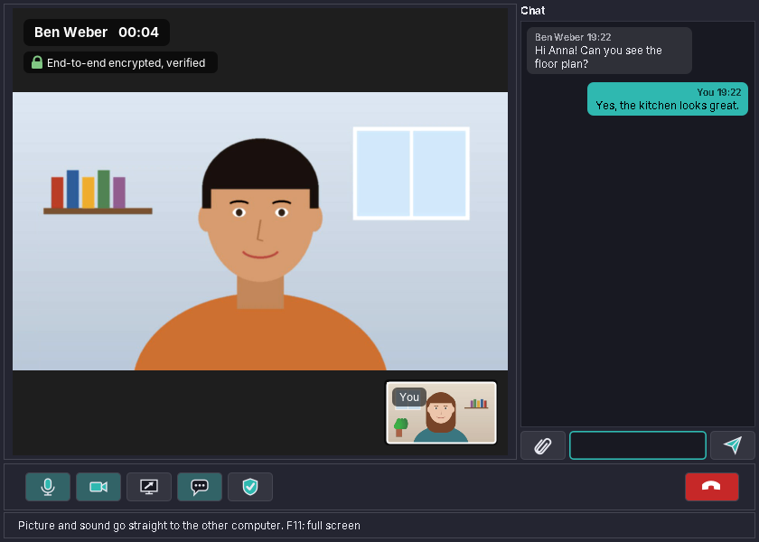
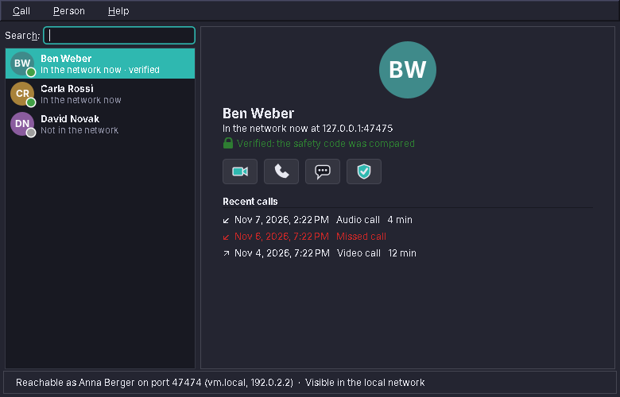
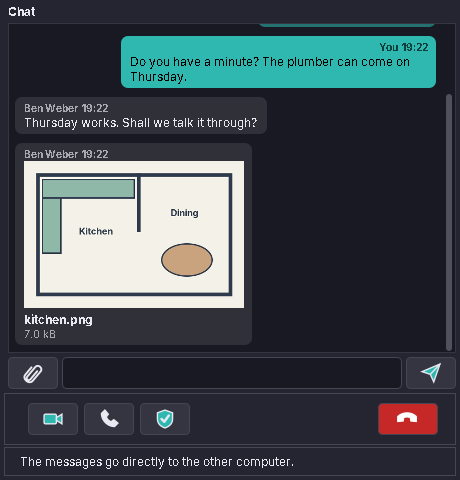
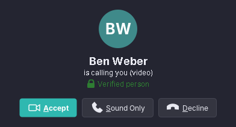

# amade-call

**amade-call** (Calls) makes video and audio calls between [amadeOS](https://github.com/amadeos-eu/amadeos) computers. Computers in the same network find each other on their own; picture and sound go straight from computer to computer, end-to-end encrypted, without a server in between. Built like the other amadeOS applications.




## Features

- **People in the network**: every computer in the same network where amade-call runs appears in the list by itself (Avahi), with the name its user chose. People called before stay in the list with their last address and the recent calls.

  
- **Calls by address** (Ctrl+L) for computers that do not show up, for example behind a VPN: a name like `anna-pc.local`, an IP address, or either with a port.
- **Video calls** with the camera, microphone and speakers chosen in the settings, or **audio calls** with sound only. The camera can be switched off and on during a call (Ctrl+E), the microphone too (Ctrl+D); the other side sees the initials instead of a black picture, and a crossed-out microphone.
- **Share the screen** instead of the camera, and back.
- **Chat** beside the picture, for links and short notes during a call.
- **Text chat** without picture and sound (Ctrl+T): the conversation fills the window. *Video Call* and *Audio Call* in the chat window end the chat and call the same person, and the chat so far moves into the call window.

  
- **Pictures and files** in the chat, up to 2 GB each: the paper clip, or drop them onto the chat. They travel through the call's encrypted connection in pieces between the chat lines, are checked with SHA-256 and land in `~/Downloads/amade-call/` (never overwriting a file there). Pictures show small in the chat; a click opens a file with its program, and a received program or script only opens its folder.
- **Kept chats**: the chat with each person (also the one beside a call) stays on this computer, encrypted with AES-256-GCM in `~/.local/share/amadeos/call/chats/`. The key lies in the login keyring (secret-tool), so the files are unreadable without the login. The next chat or call shows the earlier lines, dimmed and with the date; *Person → Clear Chat History* deletes them, and the setting can turn it off.
- **Incoming calls** ring in a window of their own, also while the main window is closed: *Accept*, *Sound Only* or *Decline*. A call that was not answered becomes a notification with *Call Back*.

  
- **Safety code**: 30 digits made from the keys of both computers. Read them out to each other once; if they match, nobody sits in between, and the person is marked as verified from then on. A different key at a known address is refused.
- **Wait for calls after login**: an autostart entry starts amade-call in the background, and closing the window keeps it waiting (*Call → Exit* ends it). A second start just shows the window.
- Full screen picture (F11), the call time, a self view in the corner, and a clear reason when a call ends (declined, busy, no answer, unreachable, connection lost).
- Five languages (English, Deutsch, Français, Español, Italiano), following the amadeOS desktop language; *Options → Language* overrides it.
- Theme colours and look from [amade-commons](https://github.com/amadeos-eu/amade-commons).

### Keys

| Key | Action |
|---|---|
| Ctrl+Enter | Video call to the selected person |
| Ctrl+Shift+Enter | Audio call to the selected person |
| Ctrl+T | Text chat with the selected person |
| Ctrl+L | Call an address |
| Ctrl+D, Ctrl+E | Microphone, camera on and off (in a call) |
| F11, Esc | Full screen picture, back |
| Ctrl+comma | Settings |
| Ctrl+Q | Exit |

## Platforms

Linux only (deb). Picture and sound go through GStreamer (`webrtcbin`, libnice, VP8, Opus, `v4l2src`, `ximagesrc`, PulseAudio/PipeWire); finding each other in the network needs `avahi-daemon` and `avahi-utils`. At start, amade-call says which GStreamer parts are missing, with their Debian package.

## How a call works

1. Each computer has its own key (Ed25519, made with `keytool` on the first start in `~/.local/share/amadeos/call/identity.p12`, readable by the user only). Its fingerprint is the computer's identity; Avahi announces the service `_amadeos-call._tcp` with name, key and port (47474, or a free one).
2. The caller opens a TLS 1.3 connection to the call port. Both sides show their certificate, and each checks that the other's key is the one it expected (from the network announcement or the list of known people).
3. Over that connection the two programs exchange short JSON messages: hello (video, audio or chat), accept or decline, then the WebRTC offer and answer and the ICE candidates, later chat lines, pictures and files (in pieces of 48 kB), camera, screen and microphone switches, and bye.
4. A text chat stops after step 3: its lines travel inside the TLS connection, and no picture or sound is set up. Picture and sound flow directly between the computers with WebRTC (DTLS-SRTP), set up by GStreamer's `webrtcbin`. The DTLS fingerprints travel inside the TLS connection of step 2, so a matching safety code covers picture and sound too.

Calls over the internet (a call server with addresses like `name@call.amadeos.eu` and a TURN relay) are planned for a later step; see [Planned](#planned).

## Architecture

Java 25, Swing and Guice; start-up, theme and language come from `AmadeApplication` in amade-commons. GStreamer is reached through [gst1-java-core](https://github.com/gstreamer-java/gst1-java-core) (LGPL).

| Package | Contents |
|---|---|
| `bootstrap` | `AmadeCallApplication` (`--background`, `--test-picture[=FILE]`), `CallModule` |
| `domain` | `PeerKey`, `SafetyCode`, `Person`, `Endpoint`, `CallKind`, `CallRecord`, `ChatLine`, `ChatFile`, `EndReason` |
| `protocol` | `Signal` (the messages), `SignalChannel` (length-prefixed JSON frames over TLS), `CallServer`, `Tls` |
| `media` | `GstMedia` and `GstSession` (the GStreamer pipeline of one call), `Devices` (cameras, microphones, speakers), `MediaSettings` |
| `service` | `Phone` (key, call port, announcement, one call at a time), `Call` (the states of one call), `ChatFiles` (pictures and files in the chat), `AvahiDiscovery`, `IdentityStore`, `Ringer`, `Autostart`, `SingleInstance` |
| `repository` | `CallPreferences`, `KnownPeers` (`people.properties`), `CallLog` (`calls.tsv`), all in `~/.config/amadeos/call/`; `ChatHistory` and `ChatKey` (encrypted chats, key in the keyring) |
| `ui.main` | main window, presenter, menus, list of people |
| `ui.call` | call window, `VideoPanel`, `ChatPanel` |
| `ui.dialogs` | incoming call, safety code, settings |

The presenter knows the windows only through `MainView`, `CallView` and `IncomingView`. The tests start two whole programs in one JVM and call from one to the other over localhost: once with real TLS, WebRTC, VP8 and Opus on GStreamer's test sources, and once with fake media through the presenters and the real Swing windows.

## Build and run

```sh
./gradlew run                                         # the first camera, microphone and speakers
./gradlew run --args="--test-picture"                 # a moving test picture instead of the camera
./gradlew run --args="--test-picture=me.jpg"          # a still picture as camera
./gradlew test                                        # needs GStreamer; Swing tests need a display: xvfb-run ./gradlew test
xvfb-run -a ./gradlew screenshots                     # the pictures in docs/screenshots
./gradlew deb                                         # build/distributions/amade-call_<version>_all.deb
./gradlew installToAmadeOs                            # the .deb into ../amadeos/config/packages.chroot/ for the ISO build
```

To try a call on one computer, start a second program with its own home and runtime folder, so that it has its own key, settings and port:

```sh
mkdir -p /tmp/ben/run && chmod 700 /tmp/ben/run
HOME=/tmp/ben XDG_RUNTIME_DIR=/tmp/ben/run ./gradlew run --args="--test-picture"
```

If `../amade-commons` is checked out next to this repository, Gradle builds against that checkout instead of the JitPack version.

## Planned

- Calls over the internet: a call server on api.amadeos.eu (addresses like `name@call.amadeos.eu`) and a TURN relay (coturn) for networks without a direct way
- Group calls
- Background blur

## License

[EUPL-1.2](LICENSE)
